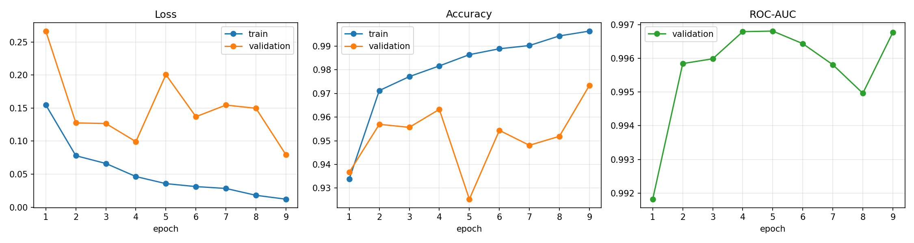
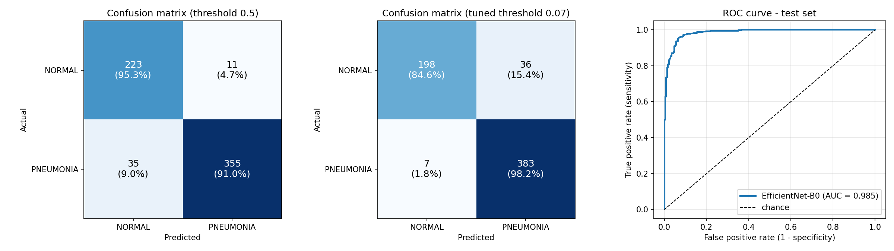
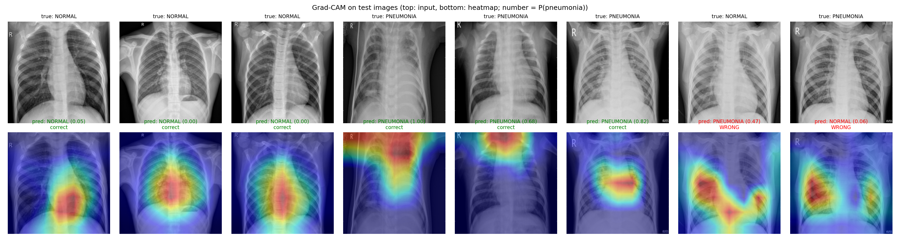

# Pneumonia Detection from Chest X-Rays with Grad-CAM

Deep-learning project (P13): classify pediatric chest X-rays as **NORMAL** or **PNEUMONIA** with a fine-tuned EfficientNet-B0, and explain each prediction with Grad-CAM heatmaps. Includes a Streamlit web demo.

Dataset: [Chest X-Ray Images (Pneumonia)](https://www.kaggle.com/datasets/paultimothymooney/chest-xray-pneumonia), Kermany et al., *Cell* 2018. 5,856 JPEG images.

## Results (official test set, 624 images, never used for training or tuning)

| Metric | Threshold 0.5 | Validation-tuned threshold (0.066) |
|---|---|---|
| Accuracy | 92.6% | **93.1%** |
| Sensitivity (recall, pneumonia) | 91.0% | **98.2%** |
| Specificity | 95.3% | 84.6% |
| Precision (pneumonia) | 97.0% | 91.4% |
| F1 (pneumonia) | 0.939 | **0.947** |
| **ROC-AUC** | **0.985** | |

The best checkpoint came from epoch 5, with validation AUC 0.997; early stopping ended training at epoch 9.
At the tuned threshold only **7 of 390 pneumonia cases are missed**. For a screening tool, a missed case costs more than a false alarm, so the threshold was chosen on the validation set (Youden's J) to favour sensitivity.

| Training curves | Confusion matrix & ROC |
|---|---|
|  |  |



## Method

1. **Patient-level re-split.** The official validation folder holds only 16 images. The official train and val sets were pooled and re-split 85/15 *by patient ID* (parsed from file names such as `person123_...`), separately for each class. No patient appears in both train and val, which avoids an optimistic validation score. The official test set is untouched.
2. **Preprocessing.** Each grayscale image is copied into 3 channels and resized to 224×224 with ImageNet normalisation. Augmentation is mild: random resized crop (scale 0.8–1.0), ±10° rotation, and brightness/contrast jitter. There are no horizontal flips, because a flip would move the heart to the wrong side.
3. **Model.** EfficientNet-B0 pretrained on ImageNet, with a new head of Dropout(0.3) and Linear(1280→2). All layers are fine-tuned.
4. **Training.**
   - Loss: class-weighted cross-entropy. The data has about 3× more pneumonia images, so the weights are NORMAL ≈ 1.94 and PNEUMONIA ≈ 0.67.
   - Optimiser: AdamW with lr 3e-4 and weight decay 1e-4, on a cosine schedule.
   - Speed: mixed precision on a Kaggle T4 GPU, with batch size 32.
   - Early stopping: training stops after 4 epochs without improvement in validation AUC.
5. **Explainability.** Grad-CAM on the last convolutional block (`features[-1]`) is implemented from scratch with forward and tensor hooks in [src/gradcam.py](src/gradcam.py).

## Project structure

```
pneumonia/
├── notebook/pneumonia_kaggle.ipynb   # full pipeline: data → training → evaluation → Grad-CAM (run on Kaggle GPU)
├── notebook/pneumonia_kaggle.py      # same notebook in "# %%" script form (source of truth)
├── notebook/build_notebook.py        # converts the .py into the .ipynb
├── app.py                            # Streamlit demo
├── src/data.py, model.py, gradcam.py # shared code used by the app
├── models/best_model.pt              # trained weights + tuned threshold
├── models/metrics.json               # test metrics shown in the app sidebar
├── results/                          # plots, classification report, training history
├── samples/                          # 6 test-set X-rays for the demo
└── tests/make_fake_data.py           # tiny fake dataset for smoke-testing the notebook locally
```

## How to run

**Train (Kaggle, free GPU):** create a Kaggle notebook and add the dataset with *Add Input*. Set Accelerator to *GPU T4 x2* and switch Internet on. Then use *File → Import Notebook* to load `notebook/pneumonia_kaggle.ipynb` and *Run All*. The run takes about 10–15 minutes. Download `pneumonia_outputs.zip` from the Output panel when it finishes.

**Demo (local, CPU is enough):**
```bash
python -m venv .venv
.venv/Scripts/activate                      # Windows; use `source .venv/bin/activate` on Linux/macOS
pip install -r requirements.txt               # installs CPU-only PyTorch
streamlit run app.py
```
The browser opens at http://localhost:8501. Upload an X-ray or pick a sample to see the prediction, the confidence score and a Grad-CAM heatmap.

## Limitations and future work

- **Dataset bias.** All images are pediatric (ages 1–5) from a single hospital in Guangzhou, so performance on adult X-rays or other scanners is unknown.
- **Shortcut learning.** Some Grad-CAM maps put attention on the upper chest and neck, or on the central mediastinum, instead of the lung fields. The model may be partly using dataset-specific cues such as patient positioning or image framing. Lung segmentation before classification, or external-dataset validation (e.g. NIH ChestX-ray14, RSNA), would test this.
- **Lower specificity at the tuned threshold.** About 15% of normal scans are flagged as pneumonia. That is acceptable for screening with a radiologist review, but not for use on its own.
- **Binary task only.** The labels do not separate bacterial from viral pneumonia, although the file names contain that information, so a 3-class model is a natural next step.
- Not a medical device. This is for academic use only.
